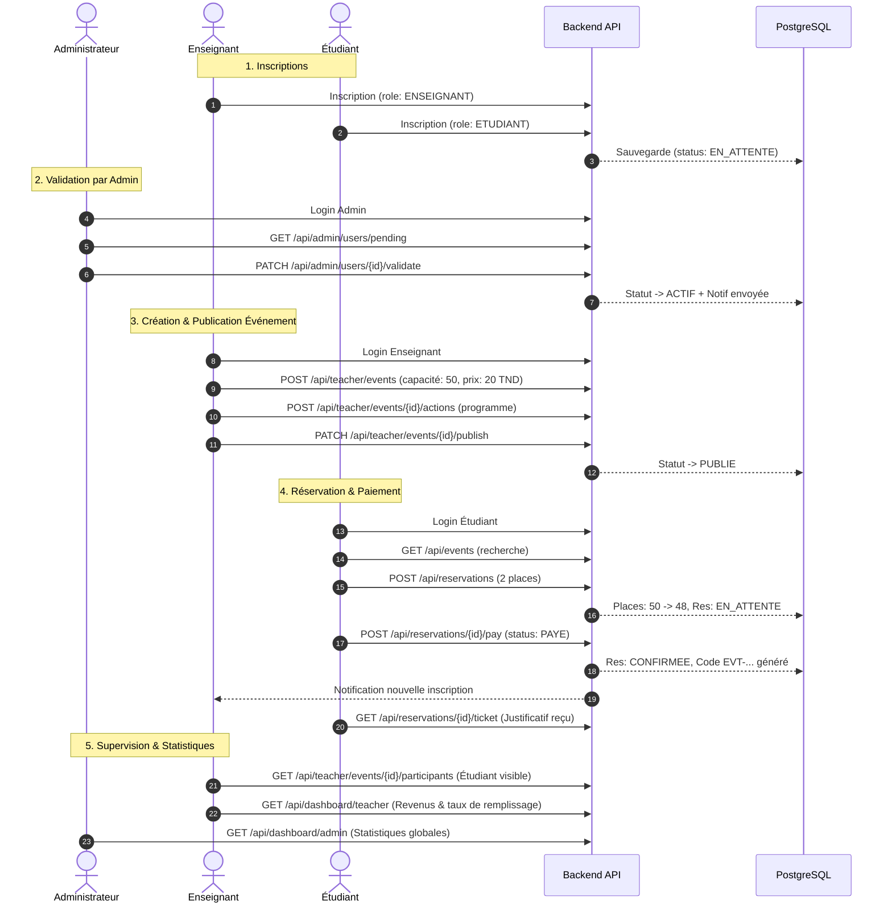

# Guide d'Utilisation par Rôle & Scénario de Démonstration

Ce document décrit le parcours fonctionnel complet de la plateforme pour chaque rôle, conformément aux spécifications du projet.

---

## 1. Rôle Administrateur

### Responsabilités :
- Valider ou refuser les nouveaux comptes d'utilisateurs (`ENSEIGNANT` ou `ETUDIANT`).
- Activer ou désactiver des utilisateurs existants.
- Superviser l'ensemble de la plateforme (statistiques globales et historique complet).

### Parcours typique :
1. Connexion avec `admin@example.com` / `admin12345678`.
2. Accès à la liste des demandes en attente (`GET /api/admin/users/pending`).
3. Validation d'un compte (`PATCH /api/admin/users/{id}/validate`). Une notification de bienvenue est automatiquement générée pour l'utilisateur.
4. Consultation du tableau de bord global (`GET /api/dashboard/admin`) :
   - Répartition des utilisateurs par statut et rôle.
   - Nombre total d'événements et de réservations.
   - Chiffre d'affaires simulé total.
5. Consultation du journal d'audit (`GET /api/history`).

---

## 2. Rôle Enseignant

### Responsabilités :
- Créer et mettre à jour ses événements.
- Organiser le programme / déroulement avec des actions datées et ordonnées.
- Publier ou annuler ses événements.
- Suivre les inscriptions et consulter la liste nominative des participants.
- Analyser les performances de ses événements (taux de remplissage et revenus).

### Parcours typique :
1. Inscription via `/api/auth/register` avec le rôle `ENSEIGNANT`.
2. Attente de la validation par l'administrateur.
3. Après validation, connexion via `/api/auth/login`.
4. Création d'un événement (`POST /api/teacher/events`) avec : titre, date, horaires, lieu, prix du ticket, capacité maximale, image.
5. Ajout d'étapes au programme (`POST /api/teacher/events/{id}/actions`).
6. Publication de l'événement (`PATCH /api/teacher/events/{id}/publish`). L'événement devient immédiatement visible au public et aux étudiants.
7. Consultation de la liste des participants (`GET /api/teacher/events/{id}/participants`).
8. Réception de notifications en temps réel lors de chaque nouvelle inscription d'étudiant.
9. Consultation du tableau de bord enseignant (`GET /api/dashboard/teacher`).

---

## 3. Rôle Étudiant

### Responsabilités :
- Parcourir le catalogue d'événements avec recherche textuelle et filtres.
- Réserver des places pour un événement publié.
- Procéder au paiement simulé (ou gratuité).
- Télécharger ou imprimer son ticket avec code de confirmation unique.
- Gérer ses réservations (annulation et libération des places).
- Consulter ses notifications et son historique personnel.

### Parcours typique :
1. Inscription via `/api/auth/register` avec le rôle `ETUDIANT`.
2. Après validation par l'administrateur, connexion via `/api/auth/login`.
3. Consultation du catalogue public (`GET /api/events` avec recherche par mot-clé, date, catégorie).
4. Création d'une réservation (`POST /api/reservations`) en indiquant le nombre de places souhaité.
5. Paiement simulé (`POST /api/reservations/{id}/pay` avec `status: "PAYE"`).
6. Téléchargement ou affichage du justificatif / ticket (`GET /api/reservations/{id}/ticket`).
7. Si besoin, annulation avant l'événement (`POST /api/reservations/{id}/cancel`) : la place est libérée et le paiement passe à `REMBOURSE`.
8. Suivi des notifications reçues (`GET /api/notifications`).

---

## 4. Scénario de Démonstration Officiel (Soutenance)

Ce scénario illustre l'intégration complète de bout en bout :

